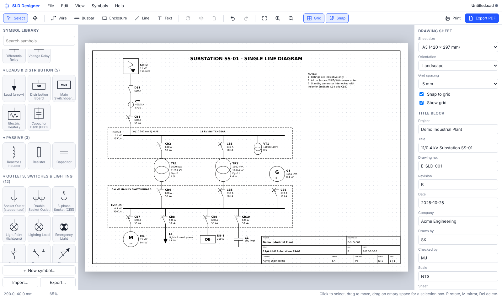

[README.md](https://github.com/user-attachments/files/35095763/README.md)
# SLD Designer

A lightweight editor for **single line diagrams (SLDs) of electrical systems** – a focused,
simplified alternative to AutoCAD Electrical for this one job.



* **Symbol library** – 131 IEC 60617‑style symbols (industrial MV/LV plus Belgian residential/RGIE: differentials, RCBOs, sockets, appliances, EV, PV/battery, bilingual NL/FR search) (sources, transformers, switchgear, protection & metering,
  loads, earthing). Create your own in the built‑in **symbol editor**, then **export / import** them as
  `.sldlib` files to share between machines.
* **Drawing tools** – place symbols, orthogonal **wires that stay connected** to terminals and busbars
  (move or rotate a symbol and its wires follow), busbars, dashed enclosures, lines, text, cable labels,
  rotate / mirror, copy / paste, box select, grid + snap, zoom / pan, unlimited undo / redo.
* **Data on the drawing** – every symbol has a tag (auto‑numbered `CB1, CB2, TR1…`) and data fields
  (rating, voltage, …) printed beside it.
* **Title block** and sheet sizes A4 – A0, landscape / portrait.
* **Files** – native project files are **`.cad`** (open / save). Export to **vector PDF** (1 : 1, print‑ready),
  **DXF** (opens in AutoCAD / LibreCAD / …) and **SVG**. *Print* opens the PDF in a new tab.
* What you see is what you print: the screen and the PDF/DXF are generated from the same drawing
  description, and a test asserts that the browser and Python renderers produce identical output.

## Run it

```bash
pip install -r requirements.txt        # flask, reportlab
python -m sld_designer                 # starts the editor and opens your browser
#   ./run.sh  or  run.bat   do the same;  --port 9000 / --no-browser are available
```

Requires Python 3.9+. No GUI toolkit is needed: the editor is a web page served from your own machine
(`127.0.0.1` only, nothing leaves your computer). Use Chrome or Edge for "Save" to overwrite the same
file; Firefox / Safari work too but download a new `.cad` each time you save.
Unsaved work is also kept in the browser and offered back after a crash or accidental close.

### Command line

```bash
python -m sld_designer export plant.cad plant.pdf       # batch export (.pdf or .dxf)
python -m sld_designer export plant.cad plant.dxf
python -m sld_designer library --export my.sldlib       # share custom symbols
python -m sld_designer library --import my.sldlib [--overwrite]
```

## Drawing in 60 seconds

1. Click a symbol in the library (left), click on the sheet to place it. **R** rotates and **M** mirrors
   while placing; **Esc** stops.
2. **B** + drag draws a busbar. **W** starts a wire: click a terminal, click corners, click a terminal or
   busbar to finish (**Space** flips the corner, **Enter** / right‑click ends).
3. Select anything to edit tag, data fields, label position / shift, cable label (wires), text, etc. in the
   panel on the right. Nothing selected = sheet size, grid and **title block**.
4. **Ctrl+S** saves the `.cad`; **Ctrl+E** exports the PDF; **Ctrl+P** prints.

| Key | Action | Key | Action |
|---|---|---|---|
| V / H | Select / Pan | Ctrl+Z / Y | Undo / Redo |
| W / B / X / L / T | Wire / Busbar / Enclosure / Line / Text | Ctrl+C / V / D | Copy / Paste / Duplicate |
| R / M | Rotate / Mirror | Del | Delete |
| F | Zoom to fit | G / F9 | Grid / Snap |
| Wheel, middle‑drag, Space‑drag | Zoom, Pan | Arrows | Nudge one grid step |

Box select: drag **left → right** to select what is fully inside, **right → left** to select anything touched.
Drag the square handles of a selected wire to move a segment, or the end handles of a busbar to resize it.

## File formats

**`.cad`** – UTF‑8 JSON (diff‑friendly, easy to generate from scripts):

```json
{ "format": "SLD-CAD", "version": 1,
  "sheet": {"size": "A3", "orientation": "landscape", "grid": 5, "snap": true, "showGrid": true},
  "title": {"project": "…", "title": "…", "number": "…", "rev": "A", "date": "…", "company": "…", …},
  "symbols":  { "cb": { …definition… } },          // every symbol used is embedded → files are self‑contained
  "elements": [ {"id":"e1","type":"sym","sym":"cb","x":60,"y":100,"rot":0,"mirror":false,
                 "tag":"CB1","attrs":{"Rating":"630 A"},"lp":"r","lo":[0,0]},
                {"id":"e2","type":"bus","x":50,"y":120,"len":190,"rot":0,"tag":"BUS-1","attrs":{…}},
                {"type":"rect|line|text", …} ],
  "wires":    [ {"id":"w3","pts":[[60,110],[60,120]],"a":{"el":"e1","t":1},"b":{"el":"e2","s":10},"label":""} ],
  "nextId": 4 }
```
Units are millimetres on the printed sheet, origin top‑left, y down. A wire end `{"el","t"}` is bound to a
symbol terminal, `{"el","s"}` to a point `s` mm along a busbar. Files are validated on load (types, ranges,
unknown fields dropped), so a damaged or hostile file is rejected with a message instead of crashing.

**`.sldlib`** – a symbol library: `{"format":"SLD-LIB","version":1,"symbols":[…]}`. A symbol is a list of
primitives (`line, poly, rect, circle, arc, text`), terminals (position + exit direction) and default data
fields – see `sld_designer/symbols_builtin.py` for 131 examples. Your own symbols are stored in
`~/.sld_designer/user_symbols.json` (override with the `SLD_HOME` environment variable).

## Layout sheets and one-project files (v2)

A `.cad` project now holds **any number of sheets**, each either an **SLD** or an electrical **Layout** (floor plan),
all in one file (`"version": 2`; v1 files open automatically). Use the tabs above the canvas, `+ SLD` / `+ Layout`,
and the *Sheet* menu (rename, reorder, delete). PDF export writes every sheet as its own page; DXF/SVG export the active sheet.

* **Layout tools:** hollow *Wall* tool (clean corners and T-junctions), lines, areas, text and ~29 plan symbols
  (lights, switches, sockets, boxes, doors, smoke detector...).
* **Equipment names are unique in the project.** A tag (e.g. `D1`, `Q0`) can be defined only once on the SLD sheets
  (case-insensitive); the editor refuses duplicates, renumbers on paste, and a file containing duplicates is repaired on
  load (second one becomes `D1_2`, and you are told). On a layout the **same equipment can be placed many times**: each plan
  symbol only *references* a name (pick it from "Equipment from the SLD" in the palette). Renaming on the SLD updates the layout.
  *Sheet > Check project* lists layout references with no SLD equipment (warning) and SLD equipment not yet placed (info).

## Example: Belgian house

`python examples/build_belgian_house.py` regenerates `examples/belgian_house.cad/.pdf/.dxf`: the residential SLD
(circuits A-L) on sheet 1 and the ground-floor layout on sheet 2. Layout-only tags (S*, P*, Q*, R*, T1, M1, O1)
have no SLD counterpart in the cropped source picture, so the check reports them as unlinked references.

## Project layout

```
sld_designer/
  render.py        project → display list (lines / circles / text in mm)      ← single source for PDF + DXF
  pdf.py dxf.py    exporters (reportlab / plain-text R12 DXF)
  project.py       .cad model + validation        library.py  symbol validation, user library, .sldlib
  symbols_builtin.py   the 131 built-in symbols     server.py   Flask API (localhost only)
  static/          the editor (core.js mirrors render.py, editor.js canvas, panel.js, palette.js, symed.js, app.js)
tests/             31 backend tests + 14 real-browser tests, and build_sample.py (draws examples/sample.cad by driving the UI)
examples/          sample.cad  sample.pdf  sample.dxf  screenshot.png
```

### Tests

```bash
pip install -r requirements-dev.txt && playwright install chromium
pytest                       # browser tests are skipped automatically if Playwright is missing
```

## Limitations (v1.0)

* **`.cad` is this tool's own format.** AutoCAD's `.dwg` is proprietary and cannot be written without a
  commercial library – use **DXF** to exchange drawings with AutoCAD. The DXF output is verified
  structurally by the tests but has not been opened in AutoCAD itself.
* One sheet per project; no automatic wire numbering, cross‑references, reports or BOM (the data is in
  the `.cad` file, so a script can produce them).
* Wire ends that land on another wire (T‑junctions) are not tied to it; only symbol terminals and busbars are.
* Labels are placed automatically (right / left / above / below plus a manual shift); they are not draggable yet.
* Fonts: DejaVu Sans is bundled (`fonts/LICENSE_DEJAVU`) so PDF and screen text match, including °, ², Ω, µ.
